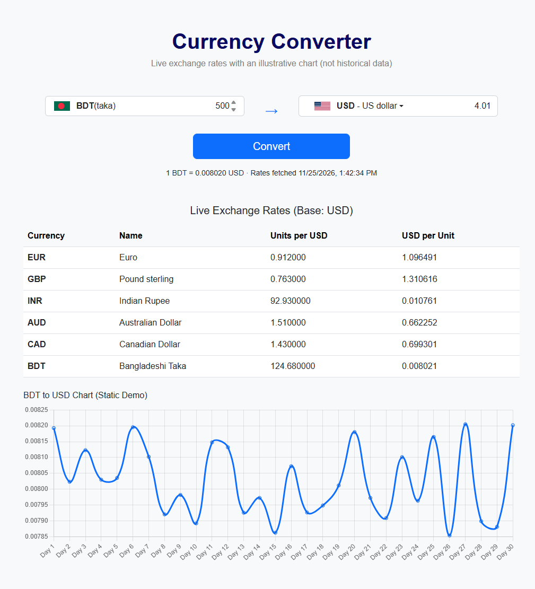
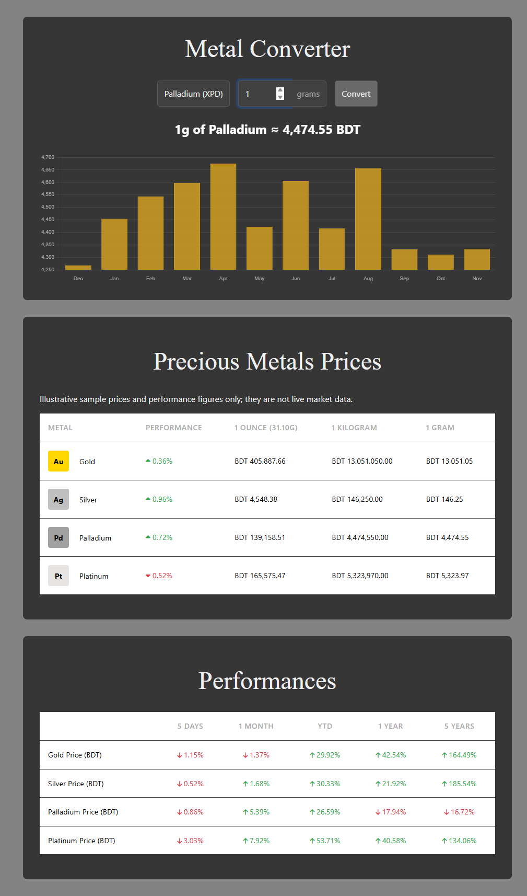
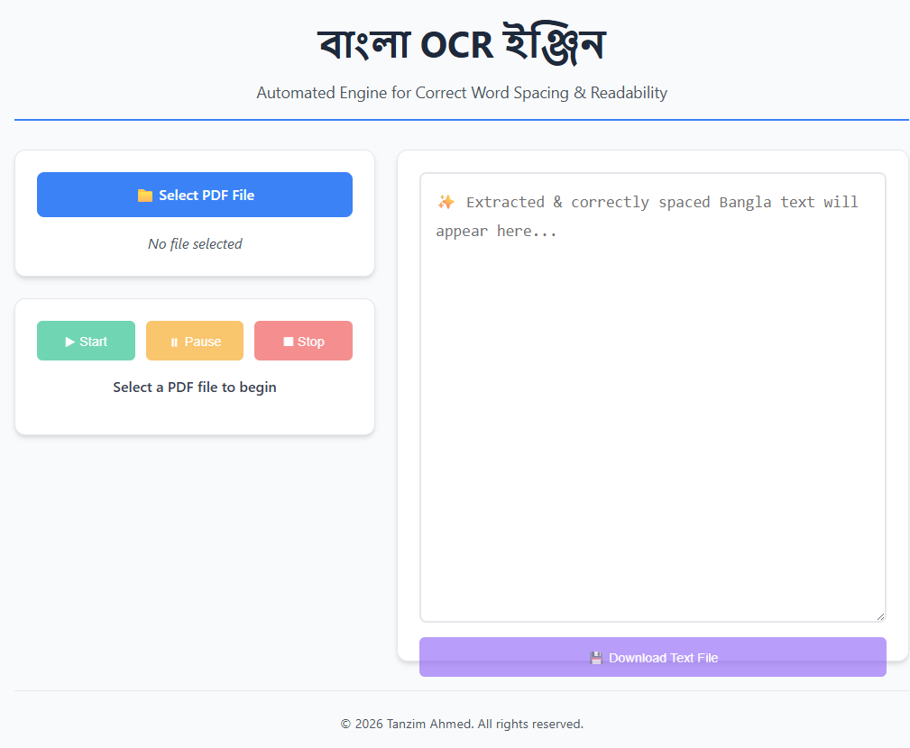
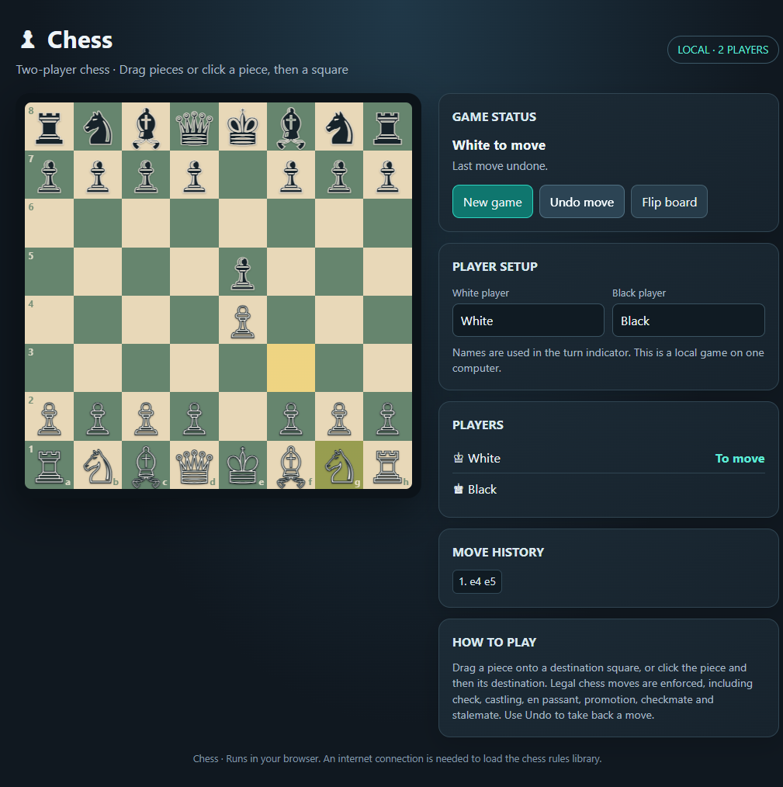
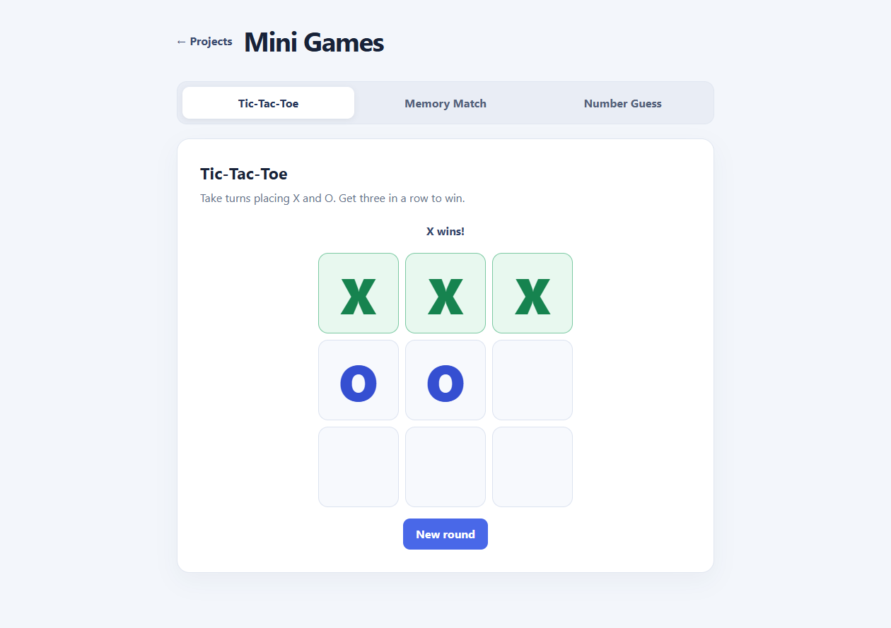
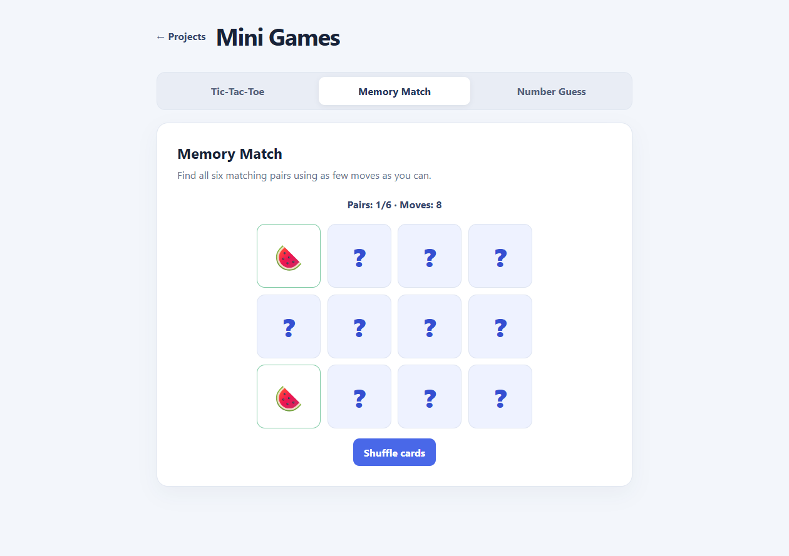
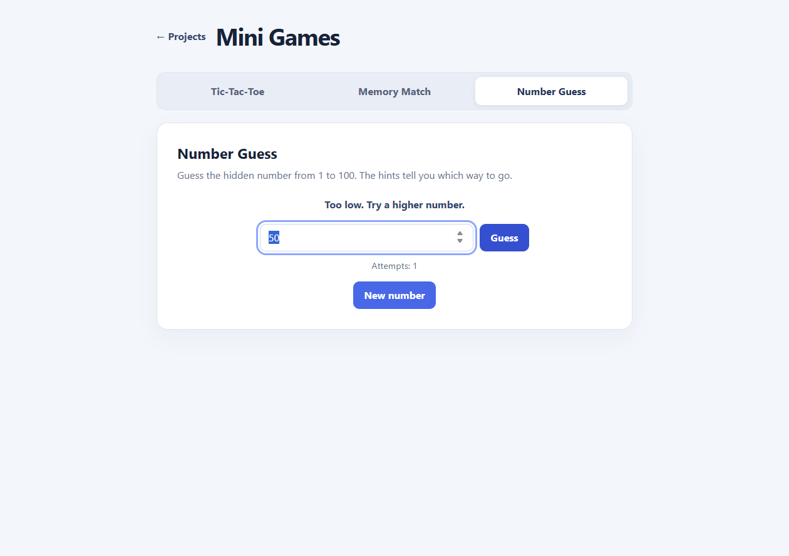

# Web Projects

A collection of standalone browser tools and games made with HTML, CSS, and JavaScript. No build step or package installation is required.

## Open a project

Open [index.html](./index.html) and select any option to launch it. Tools and games run independently; the mini-games share one page with separate tabs.

## Projects

| Project | Page | Details |
| --- | --- | --- |
| Currency Converter | [currency.html](./BDT-ExchangeHub/Currency%20Converte%20and%20Growth%20Rate/currency.html) | Converts BDT to popular currencies and lists USD-based exchange rates. The chart is illustrative, randomly generated data, not historical rates. |
| Metal Price Hub | [metal.html](./BDT-ExchangeHub/Precious%20Metal%20Price%20Convertion%20and%20Growth%20Rate/metal.html) | Converts gram amounts for gold, silver, palladium, and platinum. The sample price table uses consistent gram, 31.10-gram ounce, and kilogram calculations. All metal prices, performance values, and chart history are examples, not live data. |
| Bangla OCR | [Bangla_OCR_Engine.html](./Bangla%20OCR%20Engine/Bangla_OCR_Engine.html) | Extracts Bangla text from PDF pages in the browser, with pause/resume, progress, and text download. |
| Chess | [ChessArena.html](./Chess%20Games/ChessArena.html) | The single chess game: local two-player play with legal moves, check/checkmate and draw detection, castling, en passant, promotion, move history, undo, and board flipping. |
| Tic-Tac-Toe | [Games/index.html#tic-tac-toe](./Games/index.html#tic-tac-toe) | Two-player game with win and draw detection. |
| Memory Match | [Games/index.html#memory-match](./Games/index.html#memory-match) | Solo card-matching game with shuffled pairs and a move counter. |
| Number Guess | [Games/index.html#number-guess](./Games/index.html#number-guess) | Solo number guessing game with higher/lower hints and an attempt counter. |

## Screenshots

These are screenshots of the projects and games; the project-selection page is intentionally not shown.

### Currency Converter

<p><a href="screenshots/currency-converter.png"></a></p>

### Metal Price Hub

<p><a href="screenshots/metal-price-hub.png"></a></p>

### Bangla OCR

<p><a href="screenshots/bangla-ocr.png"></a></p>

### Chess

<p><a href="screenshots/chess.png"></a></p>

### Tic-Tac-Toe

<p><a href="screenshots/tic-tac-toe.png"></a></p>

### Memory Match

<p><a href="screenshots/memory-match.png"></a></p>

### Number Guess

<p><a href="screenshots/number-guess.png"></a></p>

## Run locally

Open a page directly in a modern browser. If local-file restrictions prevent an app from working, serve the repository directory over HTTP. For example, with Python installed:

```powershell
python -m http.server 8000
```

Then open `http://localhost:8000`.

## External services and data

- The currency page fetches exchange rates from ExchangeRate-API. Its chart is demo data.
- The OCR page loads PDF.js, Tesseract.js, and Bangla OCR language data from CDNs. PDF rendering and OCR run in the browser.
- Chess loads chess.js from a CDN to enforce chess rules.
- The mini-games do not require external libraries.
- The metal page uses static/simulated example data and is not a source of current market prices.

An internet connection is required for the pages that load external services, libraries, or OCR language data.

## Repository layout

```text
index.html                                     Project launcher
BDT-ExchangeHub/
  Currency Converte and Growth Rate/
    currency.html                              Currency converter
  Precious Metal Price Convertion and Growth Rate/
    metal.html                                 Metal price hub
Bangla OCR Engine/
  Bangla_OCR_Engine.html                       Bangla PDF OCR
Chess Games/
  ChessArena.html                              Chess
Games/
  index.html                                   Tic-Tac-Toe, Memory Match, Number Guess
screenshots/                                   Project and game screenshots
```
